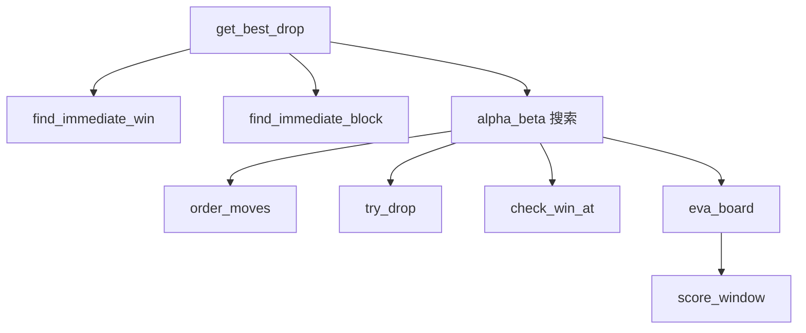

# add.py — 四子棋 AI 引擎

基于 **Alpha-Beta 剪枝搜索** 的四子棋（Connect Four）AI 决策引擎。棋盘为 6 行 × 7 列，支持红（RED=1）、黄（YELLOW=2）双方对战。

---

## 目录

- [常量定义](#常量定义)
- [棋盘操作](#棋盘操作)
- [胜负判定](#胜负判定)
- [局面评估](#局面评估)
- [搜索算法](#搜索算法)
- [走法决策](#走法决策)
- [调用流程](#调用流程)

---

## 常量定义

| 常量 | 值 | 说明 |
|------|-----|------|
| `ROWS` | 6 | 棋盘行数 |
| `COLS` | 7 | 棋盘列数 |
| `EMPTY` | 0 | 空格 |
| `RED` | 1 | 红方 |
| `YELLOW` | 2 | 黄方 |

### 评估权重

| 常量 | 值 | 说明 |
|------|-----|------|
| `THREE_SCORE` | 1000 | 活三（3 子 + 1 空）分数 |
| `TWO_SCORE` | 10 | 活二（2 子）分数 |
| `ONE_SCORE` | 1 | 单子分数 |
| `POSITION_BONUS` | 2 | 中间列（列 3、4）位置加成 |
| `LOW_ROW_BONUS` | 1 | 低行（行 0、1）位置加成 |

### 走法排序

`CENTER_RANK` 字典定义了列的优先级映射，越靠近中间的列优先级越高：

```
列索引:  0   1   2   3   4   5   6
优先级:  5   3   1   0   2   4   6    （越小越优先）
```

---

## 棋盘操作

### `get_lowest_empty_row(board, col) -> int`

返回指定列中最低空行的行号。棋盘行号 0 为底部，5 为顶部。

- **参数**: `board` — 6×7 二维列表；`col` — 列索引 (0–6)
- **返回**: 最低空行的行号，若列已满返回 `-1`
- **复杂度**: O(ROWS)，最坏 6 次比较

```python
# 示例：col=3, 该列第 0、1 行已落子
# → 返回 2
```

### `try_drop(board, col, player) -> (new_board, row) | (None, None)`

在指定列尝试落子，返回深拷贝后的新棋盘和落子行号。

- **参数**: `player` — `RED` 或 `YELLOW`
- **返回**: `(新棋盘, 行号)` 成功；`(None, None)` 列已满
- **注意**: 使用 `[r[:] for r in board]` 深拷贝，不会修改原棋盘

### `get_not_full_list(board) -> list[int]`

返回所有尚未满的列索引列表。

- **判断逻辑**: 检查每列顶部 `board[5][c]` 是否为空
- **复杂度**: O(COLS)，7 次检查

### `is_board_full(board) -> bool`

判断棋盘是否已满（平局）。

### `order_moves(moves, last_move_col=None) -> list[int]`

走法排序，用于 Alpha-Beta 剪枝的启发式优化。

- **排序规则**:
  1. 优先中间列（`CENTER_RANK` 映射），提升剪枝效率
  2. 其次靠近 `last_move_col` 的列
- **作用**: 使好的走法优先搜索，大幅提升 Alpha-Beta 剪枝效率

---

## 胜负判定

### `check_win_at(board, r, c, player) -> bool`

**增量检查** — 仅检查从 `(r, c)` 出发的四个方向是否形成四连。

| 方向 | 检查逻辑 |
|------|---------|
| 水平 ↔ | 向左 + 向右扩展 |
| 垂直 ↕ | 向上 + 向下扩展 |
| 正斜线 ↗↙ | 右下左上 |
| 反斜线 ↖↘ | 右上左下 |

- **复杂度**: O(1)，最坏每个方向检查 7 格
- **用途**: 落子后立即判断，无需扫描全盘

### `check_win(board, player) -> bool`

全盘扫描判定（遍历所有格子调用 `check_win_at`）。

- **用途**: 仅用于需要全盘扫描的罕见场景
- **复杂度**: O(ROWS × COLS) = O(42)

---

## 局面评估

### `score_window(player_cnt, opponent_cnt) -> int`

评估一个 4 格滑动窗口的得分。每个窗口内 `player_cnt + opponent_cnt + empty_cnt == 4`。

| 情况 | 分值 |
|------|------|
| 我方 4 子 | `+10000` |
| 对方 4 子 | `-10000` |
| 我方 3 子 + 1 空（活三） | `+1000` |
| 对方 3 子 + 1 空 | `-1000` |
| 2 子 | `±10` |
| 1 子 | `±1` |

### `eva_board(board, player) -> int`

评估整个棋盘相对于 `player` 的得分。

1. **滑动窗口扫描** — 遍历四个方向（水平、垂直、正斜线、反斜线）的所有 4 格窗口，调用 `score_window()` 累加
2. **位置加成** — 中间列（3、4）和低行（0、1）上的棋子获得额外加分

- **复杂度**: O(ROWS × COLS) ≈ O(42)，遍历约 69 个窗口

---

## 搜索算法

### `alpha_beta(board, depth, alpha, beta, is_maximizing, player, last_move_col) -> int | float`

**Alpha-Beta 剪枝搜索**，是 AI 决策的核心。

```
function alpha_beta(node, depth, α, β, maximizingPlayer):
    if depth == 0 or node is terminal:
        return evaluate(node)

    if maximizingPlayer:
        value = -∞
        for each child:
            if child is winning: return +1000000  // 立即返回
            value = max(value, alpha_beta(child, depth-1, α, β, false))
            α = max(α, value)
            if α ≥ β: break  // β 剪枝
        return value
    else:
        value = +∞
        for each child:
            if child is winning: return -1000000  // 立即返回
            value = min(value, alpha_beta(child, depth-1, α, β, true))
            β = min(β, value)
            if α ≥ β: break  // α 剪枝
        return value
```

**关键优化**：
- **走法排序**: `order_moves()` 使好的走法优先搜索 → 更多剪枝
- **提前终止**: 发现必胜走法立即返回 `±1000000`
- **胜负在父层检查**: 落子后的胜负由父层在递归前检查，避免无谓深入

---

## 走法决策

### `find_immediate_win(board, player) -> int`

检查玩家是否有一列可立即获胜。遍历所有非满列，模拟落子后检查四连。

- **返回**: 获胜列索引，无则 `-1`

### `find_immediate_block(board, player) -> int`

检查是否需要堵住对手的必胜走法。

- **等价于**: `find_immediate_win(board, 3 - player)`

### `get_best_drop(board, current_player) -> int`

**主函数** — 给定棋盘和当前玩家，返回最佳落子列。

**决策流程**：

```
                    ┌──────────────────┐
                    │ get_best_drop()  │
                    └────────┬─────────┘
                             │
                    ┌────────▼─────────┐
                    │ 1. 立即获胜？     │──是──▶ 返回该列
                    └────────┬─────────┘
                             │ 否
                    ┌────────▼─────────┐
                    │ 2. 需要防守？     │──是──▶ 返回堵截列
                    └────────┬─────────┘
                             │ 否
                    ┌────────▼─────────┐
                    │ 3. Alpha-Beta    │
                    │    搜索决策      │
                    └────────┬─────────┘
                             │
                    ┌────────▼─────────┐
                    │ 动态深度:        │
                    │  空 > 30 → 深6   │
                    │  空 > 20 → 深8   │
                    │  否则   → 深10   │
                    └────────┬─────────┘
                             │
                    ┌────────▼─────────┐
                    │ 返回最优列       │
                    └──────────────────┘
```

**动态搜索深度**：根据棋盘空格数自适应调整，开局搜索较浅（速度快），残局搜索更深（精度高）。

| 空格数 | 搜索深度 |
|--------|---------|
| > 30 | 6 |
| 21–30 | 8 |
| ≤ 20 | 10 |

---

## 调用流程

```python
# 典型调用示例
board = [[0]*7 for _ in range(6)]
current_player = RED

# 人类落子后，获取 AI 的最佳走法
best_column = get_best_drop(board, current_player)
# → 返回 0–6 的最佳列索引
```



---

## 算法特点总结

| 特性 | 实现 |
|------|------|
| 搜索算法 | Alpha-Beta 剪枝（Minimax 优化） |
| 评估方式 | 四格滑动窗口 + 位置加成 |
| 剪枝优化 | 走法排序（中间列优先）、必胜提前返回 |
| 深度策略 | 动态深度（6/8/10），随局面推进加深 |
| 增量判定 | `check_win_at` 仅检查落子点四方向 |
| 时间复杂度 | 搜索树分支因子约 7，带剪枝后显著降低 |
